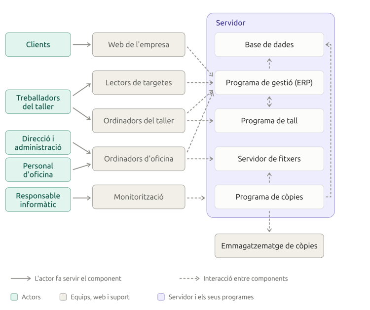
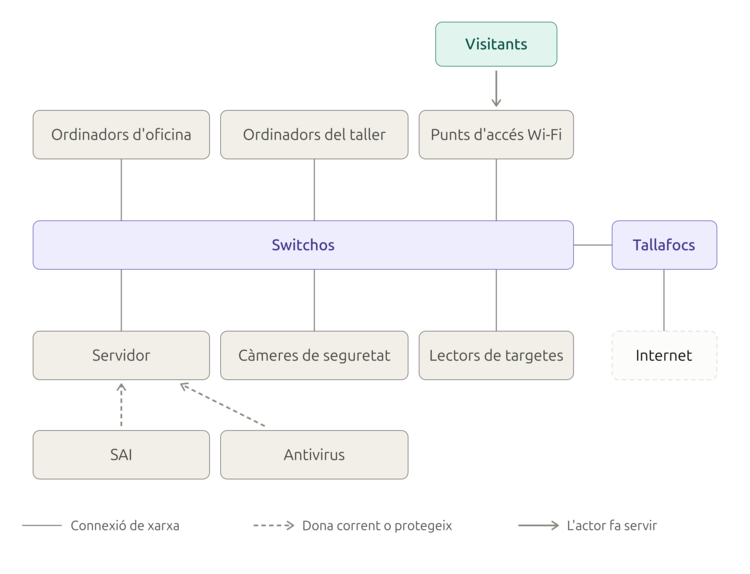

#### Definició del sistema

El sistema informàtic de La FUSTA té tres parts: els components (maquinari i programari), com es relacionen entre ells i les persones que el fan servir. Aquí el expliquem de manera general, sense triar encara marques ni programes concrets.

##### Composició

Cada component és una sola cosa: un aparell o un programa.

**Maquinari (els aparells)**

- **Servidor:** l'ordinador central. Executa els programes i guarda les dades.
- **Ordinadors d'oficina:** els que fan servir la direcció i el personal d'oficina.
- **Ordinadors del taller:** els que fan servir els treballadors del taller.
- **Switchos:** connecten tots els equips a la xarxa.
- **Tallafocs:** protegeix la xarxa dels atacs d'Internet.
- **Punts d'accés Wi-Fi:** donen connexió sense cables. Els visitants tenen una xarxa separada.
- **Càmeres de seguretat:** vigilen les entrades i el magatzem.
- **Lectors de targetes:** controlen qui entra i registren l'horari dels treballadors.
- **SAI:** una bateria que dona corrent al servidor i als switchos si hi ha un tall de llum.
- **Emmagatzematge de còpies:** lloc on es guarden les còpies de seguretat. On serà, es decidirà més endavant.

**Programari (els programes)**

- **Base de dades:** guarda les dades de l'empresa.
- **Programa de gestió (ERP):** porta els clients, els projectes, la comptabilitat, els treballadors i les incidències.
- **Servidor de fitxers:** guarda els documents que comparteix el personal.
- **Programa de tall de fusta:** calcula com tallar per aprofitar millor el material.
- **Web de l'empresa:** pàgina pública perquè els clients ens coneguin i ens contactin. On s'allotja, es decidirà més endavant.
- **Programa de còpies de seguretat:** fa les còpies automàticament.
- **Programa de monitorització:** vigila els equips i avisa si alguna cosa falla.
- **Antivirus:** protegeix els ordinadors i el servidor dels virus.

##### Estructura

**Com es relacionen els components**

- **Ordinadors d'oficina → Programa de gestió:** porten clients, projectes i comptabilitat.
- **Ordinadors d'oficina → Servidor de fitxers:** guarden i obren documents.
- **Ordinadors del taller → Programa de gestió:** consulten les feines i avisen d'incidències.
- **Ordinadors del taller → Programa de tall:** preparen i fan el tall.
- **Programa de gestió → Base de dades:** guarda i llegeix les dades.
- **Programa de gestió ↔ Programa de tall:** l'ERP envia les feines i el programa de tall torna el material gastat.
- **Web de l'empresa → Programa de gestió:** les peticions dels clients arriben a l'ERP.
- **Lectors de targetes → Programa de gestió:** envien l'hora d'entrada i de sortida dels treballadors.
- **Programa de còpies → Base de dades i servidor de fitxers:** copia les dades.
- **Programa de còpies → Emmagatzematge de còpies:** hi guarda les còpies.
- **Programa de monitorització → Servidor i switchos:** vigila que funcionin bé.
- **Antivirus → Ordinadors i servidor:** els protegeix dels virus.
- **SAI → Servidor:** li dona corrent si hi ha un tall de llum.
- **Càmeres de seguretat → Servidor:** envien el vídeo per guardar-lo.
- **Switchos → Ordinadors, Wi-Fi i servidor:** els connecten a la xarxa.
- **Tallafocs → Switchos:** controla el que entra i el que surt cap a Internet.

**Tipus de components segons les seves interaccions**

- **Només interns:** ningú de fora els fa servir directament. Són el servidor, la base de dades, el programa de gestió, el servidor de fitxers, el programa de tall, l'emmagatzematge de còpies, l'antivirus, el SAI, les càmeres i els switchos.
- **Interns i externs:** les persones de fora els fan servir directament. Són els ordinadors d'oficina, els ordinadors del taller, la web, el Wi-Fi, els lectors de targetes, el programa de còpies, el programa de monitorització i el tallafocs.

##### Entorn

Els actors són les persones que fan servir el sistema.

- **Direcció i administració**
  - Volen: portar la comptabilitat i controlar l'empresa.
  - Fan servir: ordinadors d'oficina.
- **Personal d'oficina**
  - Volen: portar clients, projectes i pressupostos.
  - Fan servir: ordinadors d'oficina.
- **Treballadors del taller**
  - Volen: consultar feines, fer el tall, avisar d'incidències i fitxar.
  - Fan servir: ordinadors del taller i lectors de targetes.
- **Clients**
  - Volen: conèixer l'empresa i demanar informació.
  - Fan servir: la web de l'empresa.
- **Visitants**
  - Volen: connectar-se a Internet.
  - Fan servir: els punts d'accés Wi-Fi.
- **Responsable informàtic**
  - Vol: mantenir el sistema, controlar les còpies i veure els avisos.
  - Fa servir: el programa de monitorització i el programa de còpies.

De moment, cap altre sistema extern interactua amb el sistema de La FUSTA.

##### Diagrames
- **Diagrama 1:** els components, els programes del servidor i els actors.
     
  
- **Diagrama 2:** la xarxa i el suport (switchos, tallafocs, SAI i antivirus).
    
