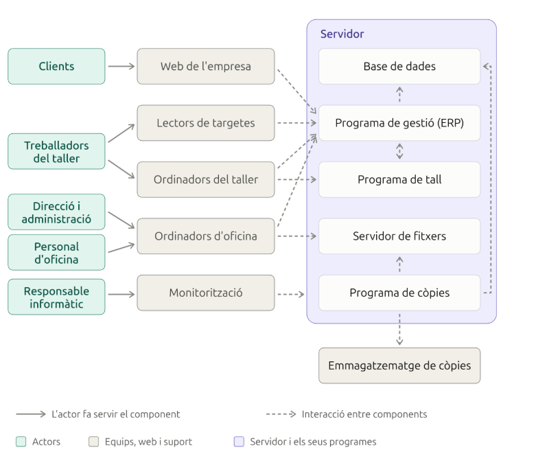
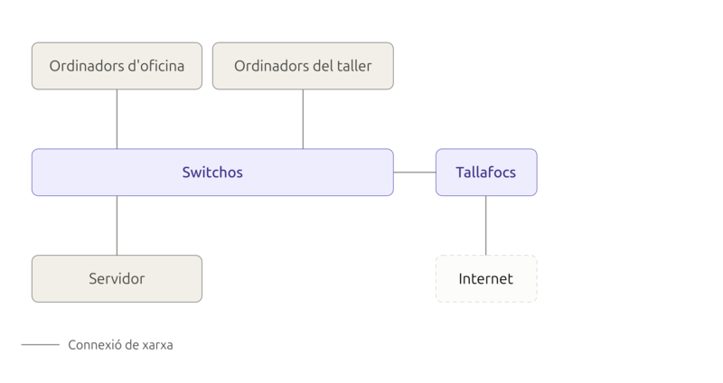

#### Definició del sistema

El sistema informàtic de La FUSTA té tres parts: els components, com es relacionen entre ells i les persones que el fan servir. L'expliquem de manera general, sense entrar en detalls.

##### Composició

Aquests són els components principals:

**Maquinari (els aparells)**

- **Servidor:** l'ordinador central, on funcionen els programes.
- **Ordinadors d'oficina:** els que fan servir la direcció i el personal d'oficina.
- **Ordinadors del taller:** els que fan servir els treballadors del taller.
- **Switchos:** connecten els equips a la xarxa.
- **Tallafocs:** protegeix la xarxa dels atacs d'Internet.

**Programari (els programes)**

- **Programa de gestió (ERP):** porta els clients, els projectes, la comptabilitat, els treballadors i les incidències.
- **Base de dades:** guarda les dades de l'empresa.
- **Programa de tall de fusta:** planifica el tall per aprofitar millor el material.
- **Web de l'empresa:** perquè els clients ens coneguin i ens contactin.
- **Programa de còpies de seguretat:** copia les dades perquè no es perdin.

##### Estructura

**Xarxa (com es connecten els aparells)**

- **Switchos → Ordinadors i servidor:** els connecten a la xarxa.
- **Tallafocs → Switchos:** controla el que entra i el que surt cap a Internet.

**Programes (qui fa servir cada programa)**

- **Ordinadors d'oficina → Programa de gestió:** porten clients, projectes i comptabilitat.
- **Ordinadors del taller → Programa de gestió:** consulten les feines i avisen d'incidències.
- **Ordinadors del taller → Programa de tall:** preparen i fan el tall.
- **Programa de gestió → Base de dades:** guarda i llegeix les dades.
- **Programa de gestió ↔ Programa de tall:** l'ERP envia les feines i el programa de tall torna el material gastat.
- **Web de l'empresa → Programa de gestió:** les peticions dels clients arriben a l'ERP.
- **Programa de còpies → Base de dades:** en fa còpies.

El servidor executa el programa de gestió, la base de dades, el programa de tall i el programa de còpies.

##### Entorn

**Actors (les persones que fan servir el sistema)**

- **Direcció i administració**
  - Volen: portar la comptabilitat i controlar l'empresa.
  - Fan servir: ordinadors d'oficina i programa de gestió.
- **Personal d'oficina**
  - Volen: portar clients, projectes i pressupostos.
  - Fan servir: ordinadors d'oficina i programa de gestió.
- **Treballadors del taller**
  - Volen: consultar feines, fer el tall i avisar d'incidències.
  - Fan servir: ordinadors del taller, programa de gestió i programa de tall.
- **Clients**
  - Volen: conèixer l'empresa i demanar informació.
  - Fan servir: la web de l'empresa.

- De moment, cap altre sistema extern interactua amb el sistema de La FUSTA.

##### Diagrames
- **Diagrama 1:** els components, els programes del servidor i els actors.
     
  
- **Diagrama 2:** la xarxa i el suport (switchos, tallafocs, SAI i antivirus).
    
